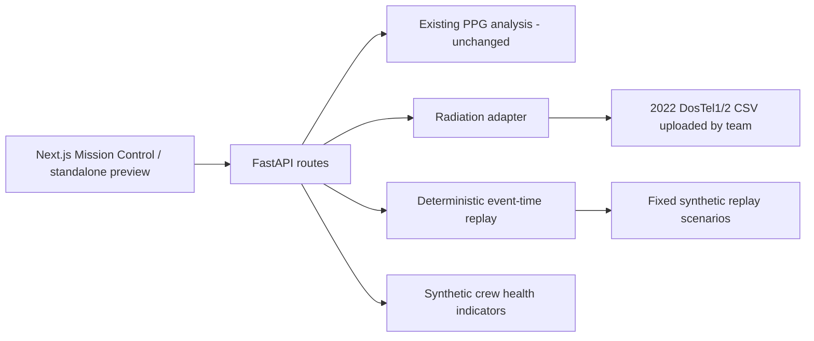

# SignalTrust v4 — Radiation Context + TimeShield Demo Architecture

**Status:** Hackathon research prototype. This document describes implemented code separately from the future production architecture. No authentication, persistent event store, durable outbox, real astronaut telemetry, patient-specific dose, or clinically verified alerting is present.

## Implemented modules and boundaries

1. **PPG:** Existing `/api/analyses`, `/api/evaluations`, `/api/datasets` and upload endpoints are unchanged. These process sample/CSV terrestrial physiological recordings.
2. **Radiation:** `radiation_service.py` reads the team's historical `nasa_radiation.csv` (182 records, two instruments, 2022), normalizes timestamps, deduplicates repeated instrument timestamps, rejects negative/nonfinite rates, finds time gaps, and integrates only accepted adjacent intervals. Integrated *absorbed instrument dose* uses trapezoidal quadrature: `(r_i+r_j)/2 * delta_seconds / 3600` in **µGy** when input is **µGy/hour**. A configurable max permitted interval is an **analysis assumption**, not a universal flight-system sampling rule. When gaps exist, full-span dose is `null`; observed-interval dose remains available with percent time coverage. Instrument-level uncertainty is `null` because calibration uncertainty is absent from supplied CSV.
3. **TimeShield:** `timeshield_service.py` processes fixed synthetic heart-rate events ordered by arrival time, identifies repeated source event IDs, and sorts canonical observations by immutable event time. A late observation can correct the historical timeline but cannot overwrite a newer event-time current value. A demo freshness watchdog uses fixed virtual time. The `IN_ORDER` and `HISTORICAL_RECONCILIATION` labels concern arrival ordering, whereas `FRESH` and `STALE` concern observation age. These are independent dimensions. The illustrative SQI/heart-rate thresholds are not clinical criteria.
4. **Frontend:** `reliabilityApi` is a typed service adapter for the four read/replay endpoints. Next.js has `/radiation` and `/timeshield`; the standalone preview uses hash routes `#radiation` and `#timeshield`. Both display source type, units, missing data, error states and limits. Existing signal lab/UI remain available.
5. **Astronaut view:** Both the admin and astronaut Next.js pages contain links to the separate environmental evidence and event-time reliability laboratories. Historical instrument readings are not merged into individual medical dosimetry.

## Endpoints (implemented)

| Method | Route | Response | Validation |
|---|---|---|---|
| GET | `/api/radiation/summary?max_interval_seconds=300` | Source metadata, per-instrument coverage, absorbed dose summary (excluding raw series) | Integer 1–3600 inclusive; default 300 |
| GET | `/api/radiation/instruments/DosTel1?max_interval_seconds=300` | Full 2022 series, excluded intervals, coverage, assumptions | Known instrument; max interval bounds |
| GET | `/api/timeshield/scenarios` | Names of fixed replay scenarios, explicit demo status | None |
| POST | `/api/timeshield/replay` | `{"scenario":"late"}` → arrival trace, canonical timeline, dedup, freshness, demonstration assessment | Unknown scenario → 422 |

Original endpoints: `/api/health`, `/api/demo/*`, `/api/datasets*`, `/api/recordings/upload`, `/api/analyses*`, `/api/evaluations` are retained. Generated OpenAPI docs remain at `/docs`.

## Correctness / safety invariants

- No missing radiation interval is silently converted into zero dose or interpolated beyond the configured maximum gap.
- Rates (`µGy/h`) and integrated absorbed dose (`µGy`) remain distinct. These are neither `mSv` nor personal/organ dose.
- Duplicate telemetry IDs do not count twice in the deterministic replay. A conflicting payload with the same event ID is rejected in the demo engine.
- A late event updates event-time history while the latest valid event-time state remains current.
- A stale measurement can still contain a legitimate physiological value, but is *not current evidence*. Likewise unreliable PPG is not proof of health.
- The TimeShield replay computes locally; it cannot shorten actual spacecraft/Earth signal propagation time.
- The user-supplied sample is **described as** a NASA RadLab export but exact authenticity was not independently hash-verified against a freshly downloaded source. Verify and cite the original RadLab query before publishing scientific results.

## Not implemented and intentionally not claimed

- `t_event` cryptographic authenticity, source sequence / signature verification, clock-drift correction.
- Multi-sensor event-time reconciliation (the current teaching fixtures use one stream).
- ACID event storage, transactionally committed outbox, PostgreSQL `LISTEN/NOTIFY`, WebSocket/gRPC stream relay, cursor ACKs, delivery gap recovery, cross-process deduplication, exactly-once delivery, or offline reconnect persistence.
- Personal radiation dose estimation, crew radiation-risk prediction, clinical action recommendations, medical-grade PPG accuracy.
- Live NASA API ingestion: the ZIP works offline from a supplied historical CSV; it never substitutes 2022 numbers for current astronaut measurements.

## Next architecture phase: durable TimeShield (design guidance only)

1. **Ingestion:** authenticated immutable source-generated event ID (ideally sensor ID + acquisition sequence), independently record UTC event timestamp and gateway arrival timestamp, validate clocks, units, channel and signatures.
2. **Durability:** committed raw event with unique constraint + per-stream watermark + state revision + outbox rows in one transaction. Use per-stream serialized transactions or a commit-order-safe publisher; `BIGSERIAL` allocation order alone is not commit order.
3. **Reconciliation:** maintain enough prior checkpoint state to recompute affected intervals; apply versioned corrections rather than silently overwrite existing assessments. Handle late data outside a replay horizon explicitly.
4. **Delivery:** persistent outbox is the source of truth; `LISTEN/NOTIFY` only wakes a relay, not durable storage. Consumers ACK a safe publication cursor, detect missing/crossed sequence ranges, and re-fetch after reconnect. A direct/session-mode PostgreSQL connection is required for `LISTEN` when using Supabase; a transaction pooler will not preserve that session state.
5. **Freshness:** store `event_time`, `arrival_time`, `processed_time`, `source_time_uncertainty`, `as_of` and independent `freshness_state` versus `reconciliation_state`. Alert severity/thresholds require clinical governance.
6. **Benchmarking:** compare baseline versus event-time reconciliation on deterministic scenarios; separately measure ingest, compute, publication, network and reconnect catch-up latencies. These are not equivalent to radio propagation latency.

## Reference documentation

- NASA Space Apps challenge: https://www.spaceappschallenge.org/2026/challenges/health-monitoring-software/
- NASA RadLab API and units: https://visualization.osdr.nasa.gov/radlab/gui/data-api/
- NASA RadLab overview: https://visualization.osdr.nasa.gov/radlab/gui/overview/
- PostgreSQL asynchronous notification: https://www.postgresql.org/docs/current/sql-notify.html
- PostgreSQL sequence behavior: https://www.postgresql.org/docs/current/functions-sequence.html
